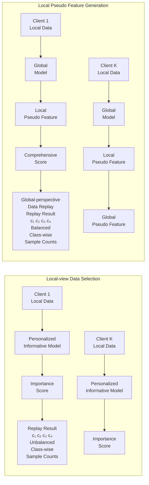

## Abstract

Class-wise Balancing Data Replay for Federated Class-Incremental Learning

Zhuang Qi^1, Ying-Peng Tang^2, Lei Meng^1,*, Han Yu^2, Xiaoxiao Li^3,4, Xiangxu Meng^1

^1 School of Software, Shandong University, China
^2 College of Computing and Data Science, Nanyang Technological University, Singapore
^3 Department of Electrical and Computer Engineering, University of British Columbia, Canada
^4 Vector Institute, Canada

z_qi@mail.sdu.edu.cn, yingpeng.tang@ntu.edu.sg, lmeng@sdu.edu.cn, han.yu@ntu.edu.sg, xiaoxiao.li@ece.ubc.ca, mxx@sdu.edu.cn

Abstract

Federated Class Incremental Learning (FCIL) aims to collaboratively process continuously increasing incoming tasks across multiple clients. Among various approaches, data replay has become a promising solution, which can alleviate forgetting by reintroducing representative samples from previous tasks. However, their performance is typically limited by class imbalance, both within the replay buffer due to limited global awareness and between replayed and newly arrived classes. To address this issue, we propose a class-wise balancing data replay method for FCIL (FedCBDR), which employs a global coordination mechanism for class-level memory construction and reweights the learning objective to alleviate the aforementioned imbalances. Specifically, FedCBDR has two key components: 1) the global-perspective data replay module aggregates encrypted and compressed pseudo features that approximate global representations of prior tasks without explicit raw data exchange, aiming to guide sampling balancing; 2) Subsequently, the task-aware temperature scaling module adaptively adjusts logits at both class and instance levels based on local task dynamics, which seeks to reduce model overconfidence and enhance sensitivity to minority classes. Experimental results verified that FedCBDR improves balanced class-wise sampling under heterogeneous data distributions and somewhat enhances generalization under task imbalance between earlier and recent tasks, yielding a 2%-15% Top-1 accuracy improvement compared to several state-of-the-art methods under evaluated settings. All datasets used have been publicly released and preprocessed in accordance with standard ethical guidelines. The experimental protocol follows federated privacy constraints, ensuring no raw client data leaves local devices, and all procedures comply with institutional data use and human subject research regulations.

## Introduction

1 Introduction

Federated learning (FL) is a distributed machine learning paradigm that enables collaborative training of a shared global model across multiple data sources [1, 2, 3, 4, 5]. It periodically performs parameter-level interaction between clients and the server instead of gathering clients’ data, which can enhance data privacy while leveraging the diversity of distributed data sources to build a more generalized global model [6, 7, 8, 9, 10, 11]. This mechanism makes it widely applicable to various fields [12, 13, 14, 15, 16]. Building upon this foundation, Federated Class-Incremental Learning (FCIL) extends FL by introducing dynamic data streams where clients sequentially encounter different task classes under non-independent and identically distributed data [17, 18, 19, 20, 21]. However, this amplifies the inherent complexities of FL, as the global model must integrate heterogeneous and

Figure 1: Motivation of FedCBDR. Traditional data replay strategies typically focus on local information and, due to the lack of global awareness, often result in imbalanced class distributions during replay. FedCBDR aims to explore global information in a privacy-preserving manner and leverage it for sampling, which can alleviate the class imbalance problem.

evolving knowledge from clients while mitigating catastrophic forgetting, despite having no or only limited access to historical data [22, 23, 24].

To address the challenge of catastrophic forgetting in FCIL, data replay has emerged as a promising strategy for retaining knowledge from previous tasks. Existing replay-based methods can be broadly categorized into two types: generative-based replay and exemplar-based replay. The former leverages generative models to synthesize representative samples from historical tasks [23, 25, 26]. Its core idea is to learn the data distribution of previous tasks and internalize knowledge in the form of model parameters, enabling the indirect reconstruction of prior knowledge through sample generation when needed [19, 27]. However, they often overlook the computational cost of training generative models and are inherently constrained by the quality and fidelity of the synthesized data [23, 28, 29]. In contrast, exemplar-based replay methods directly store real samples from previous tasks, avoiding the complexity of generative processes while leveraging high-quality raw data to ensure robust retention of prior knowledge [17, 28, 30, 31]. These methods rely on a limited set of historical samples to maintain the decision boundaries of previously learned task classes. However, due to the lack of a global perspective on data distribution across clients, these methods are prone to class-level imbalance in replayed samples, which undermines the model's ability to retain prior knowledge [30, 31].

To address these issues, this paper proposes a class-wise balancing data replay method for FCIL, termed FedCBDR, which incorporates the global signal to regulate class-balanced memory construction, aiming to achieve distribution-aware replay and mitigate the challenges posed by non-IID client data, as illustrated in Figure 1. Specifically, FedCBDR comprises two primary modules: 1) the global-perspective data replay (GDR) module reconstructs a privacy-preserving pseudo global representation of historical tasks by leveraging feature space decomposition, which enables effective cross-client knowledge integration while preserving essential attribute information. Furthermore, it introduces a principled importance-driven selection mechanism that enables class-balanced replay, guided by a globally informed understanding of data distribution; 2) the task-aware temperature scaling (TTS) module introduces a multi-level dynamic confidence calibration strategy that combines task-level temperature adjustment with instance-level weighting. By modulating the sharpness of the softmax distribution, it balances the predictive confidence between majority and minority classes, enhancing the model's robustness to class imbalance between historical and current task samples.

Extensive experiments were conducted on three datasets with different levels of heterogeneity, including performance comparisons, ablation studies, in-depth analysis, and case studies. The results demonstrate that FedCBDR effectively balances the number of replayed samples across classes and alleviates the long-tail problem. Compared to six state-of-the-art existing methods, FedCBDR achieves a 2%–15% Top-1 accuracy improvement.

## Related Work

2 Related Work

2.1 Exemplar-based Replay Methods

In FCIL, exemplar-based replay methods aim to mitigate catastrophic forgetting by storing and replaying a subset of samples from previous tasks. They typically maintain a small exemplar buffer on each client, which is used during training alongside new task data to preserve knowledge of

<!-- Caption: Related Work, index 7 -->

Previously learned classes [17, 30, 31, 32, 33, 34]. For example, GLFC alleviates forgetting in FCIL by leveraging local exemplar buffers for rehearsal, while introducing class-aware gradient compensation and prototype-guided global coordination to jointly address local and global forgetting [17]. Moreover, Re-Fed introduces a Personalized Informative Model to strategically identify and replay task-relevant local samples, enhancing the efficiency of buffer usage and further reducing forgetting in heterogeneous client environments [30]. However, the lack of global insight in local sample selection often results in class imbalance, while the long-tailed distribution between replayed and current data is frequently overlooked, degrading the effectiveness of data replay [30, 31].

## 2.2 Generative-based Replay Methods

Generative replay methods aim to reconstruct the samples of past tasks through techniques such as generative modeling [19, 23, 27, 35, 36], which enables the model to revisit historical knowledge to mitigate catastrophic forgetting. Following this line of thought, TARGET generates pseudo features through a globally pre-trained encoder and performs knowledge distillation by aligning the current model’s predictions with those of a frozen global model [27]; LANDER utilizes pre-trained semantic text embeddings as anchors to synthesize meaningful pseudo samples, and distills knowledge by aligning the model’s predictions with class prototypes derived from textual descriptions [19]. However, these methods are typically limited by the high computational cost of training generative models and the suboptimal performance caused by low-fidelity pseudo samples [19, 27].

## 2.3 Knowledge Distillation-based Methods

Knowledge distillation-based methods generally follow two paradigms. The first focus on aligning the output predictions of the current model with those of previous models, which aims to preserve task-specific decision boundaries [37, 38, 39, 40, 41, 42, 43, 44, 45]. The second estimates the importance of model parameters for previously learned tasks and performs regularization to prevent forgetting [46, 47]. Both approaches avoid storing raw data but are prone to knowledge degradation over time, especially as the number of tasks increases [37, 46].

## Preliminaries

## 3 Preliminaries

We consider a federated class-incremental learning (FCIL) setting, where a central server aims to collaboratively train a global model with the assistance of $$K$$ distributed clients. Each client $$k$$ receives a sequence of classification tasks $$\{\mathcal{D}_k^{(1)}, \mathcal{D}_k^{(2)}, \ldots, \mathcal{D}_k^{(t)}\}$$, where each task introduces a disjoint set of new classes. Upon the arrival of task $$t$$, the global model parameters $$\theta_t$$ are optimized to minimize the average loss over the union of all samples seen so far, i.e., $$\mathbb{D}^t = \bigcup_{s=1}^t \bigcup_{k=1}^K \mathcal{D}_k^{(s)}$$, by solving $$\min_\theta \frac{1}{|\mathbb{D}^t|} \sum_{s=1}^t \sum_{k=1}^K \sum_{i=1}^{N_k^{(s)}} \mathcal{L}(f_k(x_{k,i}^{(s)}; \theta), y_{k,i}^{(s)})$$.

In replay-based methods, each client maintains a memory buffer with a fixed budget of $$M$$ samples. When task $$t$$ arrives, the client selects up to $$N$$ representative samples from each of the previous tasks $$\{1, \ldots, t-1\}$$, subject to the total memory constraint. The resulting memory set is denoted by $$\mathcal{B}_k^{(t-1)} = \bigcup_{s=1}^{t-1} \{(x_{k,i}^{(s)}, y_{k,i}^{(s)})\}_{i=1}^N$$, where $$N$$ is the number of samples stored per task and $$|\mathcal{B}_k^{(t-1)}| \leq M$$. The local training set on client $$k$$ then becomes $$\mathcal{D}_{k,\text{train}}^{(t)} = \mathcal{D}_k^{(t)} \cup \mathcal{B}_k^{(t-1)}$$, combining current and replayed samples. Based on these local datasets, the server updates the global model by minimizing the aggregated loss: $$\min_\theta \sum_{k=1}^K \sum_{(x,y) \in \mathcal{D}_{k,\text{train}}^{(t)}} \mathcal{L}(f_k(x; \theta), y)$$.

## Method

## 4 Class-wise Balancing Data Replay for Federated Class-Incremental Learning

This section presents an effective active data selection method for FCIL, which aims to explore global data distribution to balance class-wise sampling. Moreover, it leverages temperature scaling to adjust the logits, which can alleviate the imbalance between samples from previously learned and newly introduced tasks. Figure 2 and Algorithm 1 illustrates the framework of the proposed FedCBDR.

Figure 2: Illustration of the FedCBDR framework. It first trains local models using samples from current and previous tasks. After a fixed number of communication rounds, each client extracts local sample features using the global model and applies inverse singular value decomposition (ISVD) to obtain pseudo features. The server then aggregates both local models and pseudo features, performs SVD on the features, and selects representative samples based on leverage scores. The corresponding sample indices are sent back to the clients for balanced replay.

4.1 Global-perspective Data Replay (GDR)

Due to privacy constraints, traditional data replay strategies typically rely on local data distributions. However, the absence of global information often leads to class imbalance in the replay buffer. To address this, the GDR module aggregates local informative features into a global pseudo feature set, enabling exploration of the global distribution without exposing raw data.

Inspired by Singular Value Decomposition (SVD) [48, 49], we first generate a set of random orthogonal matrices: a client-specific matrix P_k^{(i)} ∈ ℝ^{|D_k^{(i)}| × |D_k^{(i)}|} for each client k and task i, and a globally shared matrix Q^{(i)} ∈ ℝ^{d × d}, where d denotes the dimension of the feature. Each client encrypts its local feature matrix X_k^{(i)} = M_g(D_k^{(i)}) via Inverse Singular Value Decomposition (ISVD):

X_k^{(i)'} = P_k^{(i)} X_k^{(i)} Q^{(i)}, (1)

and uploads the encrypted matrix X_k^{(i)'} to the server, where M_g(·) is the feature extractor of the global model. The server then aggregates all encrypted matrices into a global matrix X^{(i)'}:

X^{(i)'} = concat{X_k^{(i)'} | k = 1, …, K}, (2)

and performs SVD as follows:

X^{(i)'} = U^{(i)'} Σ^{(i)'} V^{(i)'}^⊤, (3)

where U^{(i)'} ∈ ℝ^{n × n}, Σ^{(i)'} ∈ ℝ^{n × d}, and V^{(i)'} ∈ ℝ^{d × d}, with n denoting the total number of samples from all clients. Next, the server extracts a submatrix of the left singular vectors for each client k by:

U_k^{(i)} = 𝕀_k(U^{(i)'}) ∈ ℝ^{|D_k^{(i)}| × n}, (4)

where 𝕀_k(·) denotes a row selection function that returns the indices corresponding to client k’s samples. To quantify the importance of local samples within the global latent space, client k computes a leverage score [50, 51, 52] for the j-th sample of task i as:

τ_k^{i,j} = ||e_{i,j}^⊤ U_k^{(i)}||_2^2, (5)

where e_{i,j} denotes the j-th standard basis vector in task i. Notably, a higher leverage score indicates that the sample has a larger projection in the low-dimensional latent space, suggesting that it contributes more significantly to the global structure and is more representative. Moreover, clients send their leverage scores to the server, which aggregates them into a global vector τ^i = concat{τ_k^{i,j} | k = 1, …, K; j = 1, …, n_k^i} and normalizes it to obtain a sampling distribution:

p_k^{i,j} = τ_k^{i,j} / ∑_{j'=1}^{n_k^i} τ_k^{i,j'}. (6)

<!-- Caption: Method, index 15 -->

## Algorithm 1 FEDCBDR

1: Initialize: R: number of communication rounds; K: number of clients; t: number of tasks; θ_g: global model parameters; 𝔅_k^{pre}: replay buffer for historical tasks on client k; 𝔇_k^s: local data of task s on client k.
2: for each task s = 1 to t do
3: for each communication round r = 1 to R do
4: for each client k = 1 to K do
5: Initialize local model parameters: θ_k ← θ_g
6: if s == 1 then
7: Sample a mini-batch ζ from 𝔇_k^{(1)}, and update θ_k using Eq. 8.
8: else
9: Store the historical task data corresponding to globally sampled IDs into 𝔅_k^{pre}.
10: Sample a mini-batch ζ from 𝔇_k^{(s)} ∪ 𝔅_k^{pre}, and update θ_k using Eq. 9.
11: Compute pseudo-features based on Eq. 1, and upload them to the server.
12: end if
13: end for
14: if r < R then
15: Aggregate local model parameters across clients.
16: else
17: Aggregate model parameters and pseudo-features from all clients using Eq. 2.
18: Perform Global Sampling based on Eqs. 3–6, and send the selected sample IDs back to the corresponding clients.
19: end if
20: end for
21: end for
22: // Global Sampling Procedure
23: Form the global feature pool X^{(i)} by aggregating all pseudo-features via Eq. (2).
24: Perform singular value decomposition (SVD) using Eq. 3 to extract key attributes.
25: Compute leverage scores for each client's samples using Eqs. 4–5, and normalize globally using Eq. 6.
26: Perform sampling and adjust the probabilities of the selected samples accordingly.

Subsequently, we perform i.i.d. sampling based on the distribution p = {p_k^{i,j} | k = 1, ..., K; j = 1, ..., n_k^i}. Once a sample x is selected, its sampling weight is adjusted to (1/√(n_s · p_x)) e_x, where n_s denotes the number of selected samples and p_x is the original sampling probability of x; e_x is the standard basis vector of x. This adjustment ensures unbiased estimation during aggregation. Following the sampling procedure, the server communicates the selected sample indices to their respective clients, where the corresponding data points are subsequently marked for further use.

## 4.2 Task-aware Temperature Scaling (TTS)

Due to limited replay budgets, samples from previous tasks are often much fewer than those from the current task, leading to class imbalance and poor retention of past knowledge. To mitigate this, the TTS module dynamically adjusts sample temperature and weight based on task order, enhancing the contribution of tail-class samples during optimization.

Specifically, we use a lower temperature to sharpen logits for samples from earlier tasks. Furthermore, to further amplify the optimization effect of tail-class samples during training, we also leverage a re-weighted cross-entropy loss, i.e.,

ℒ_TTS = (1/(N_old + N_new)) × \Big( ω_{old} ∑_{i=1}^{N_{old}} CE(y_i, Softmax(z_i^{old} / τ_{old})) + ω_{new} ∑_{j=1}^{N_{new}} CE(y_j, Softmax(z_j^{new} / τ_{new})) \Big) (7)

Here, N_{old} and N_{new} are the number of old and new task samples; y_i and y_j are their labels; z_i^{old} and z_j^{new} are logits corresponding to old and new classes; τ_{old} and τ_{new} are temperature parameters applied separately to old and new class logits; ω_{old} and ω_{new} are sample weighting coefficients. This separate normalization clarifies temperature scaling within each task's logits before loss aggregation.

## Experiments

Table 1: Statistics of the datasets used in experiments.

| Datasets     | #Class | #Training | #Testing | Image Size | Federated Settings Clients | Federated Settings Tasks | Federated Settings Heterogeneity |
| ------------ | ------ | --------- | -------- | ---------- | -------------------------- | ------------------------ | -------------------------------- |
| CIFAR10      | 10     | 50,000    | 10,000   | 32 × 32    | 5/10                       | 3/5                      | 0.5/1.0                          |
| CIFAR100     | 100    | 50,000    | 10,000   | 32 × 32    | 5/10                       | 5/10                     | 0.1/0.5/1.0                      |
| TinyImageNet | 200    | 100,000   | 10,000   | 64 × 64    | 5/10                       | 10/20                    | 0.1/0.5/1.0                      |

The cross-entropy loss function; and Softmax(z/τ) is the temperature-scaled softmax function used to adjust the sharpness of the output distribution.

## Method

## 4.3 Training Strategy

The training strategy consists of two stages to progressively address the evolving challenges in federated class-incremental learning. Algorithm 1 presents the pipeline of the FedCBDR.

Stage 1: Initial Task Optimization. In the first task, client k learns from local data using the standard cross-entropy loss, i.e.,
min_{θ_k} (1/N) Σ_{i=1}^{N} CE(y_i, Softmax(f_{θ_k}(x_i))),
(8)

Stage 2: Class-Incremental Optimization. As new tasks arrive and class imbalance emerges between previous and current tasks in client k, we employ L_{TTS} to mitigate the imbalance, i.e.,
min_{θ_k} (1/N_{old}) Σ_{i=1}^{N_{old}} ω_{old} · CE( y_i, Softmax( Concat( f_{θ_k}^{old}(x_i)/τ_{old}, f_{θ_k}^{new}(x_i)/τ_{new} ))) + (1/N_{new}) Σ_{j=1}^{N_{new}} ω_{new} · CE( y_j, Softmax( Concat( f_{θ_k}^{old}(x_j)/τ_{old}, f_{θ_k}^{new}(x_j)/τ_{new} )))
(9)

where x_i is the input sample, y_i is the corresponding ground-truth, f_{θ_k}^{old}(x) and f_{θ_k}^{new}(x) represent the outputs of the model corresponding to old and new classes, respectively. Softmax(·) converts the logits into a probability distribution.

## Experiments

# 5 Experiments

## 5.1 Experiment Settings

Datasets. Following existing studies [27, 30], we conducted all experiments on three commonly used datasets, including CIFAR10 [53, 54], CIFAR100 [53, 54] and TinyImageNet [55] to validate the effectiveness of the FedCBDR. We simulate heterogeneous data distributions across clients using the Dirichlet distribution with parameters β = {0.1, 0.5, 1.0}, where smaller values of β correspond to higher level of data heterogeneity. The statistical details are presented in Table 1.

Evaluation Metric. Following prior studies [19, 56, 57, 58], we adopt Top-1 Accuracy as the evaluation metric, defined as Accuracy = N_{correct}/N_{total}, where N_{correct} and N_{total} denote the number of correct predictions and the total number of samples, respectively.

Implementation Details. In the experiments, the number of clients is fixed at K = 5, with each client running local epochs E = 2 per round, using a batch size B = 128. For all datasets, we adopt ResNet-18 as the backbone, with the classifier’s output dimension dynamically updated as tasks progress and conduct T = 100 communication rounds per task. The SGD optimizer is employed with a learning rate of 0.01 and a weight decay of 1 × 10^{-5}. The number of stored samples per task varies by dataset and split setting: for CIFAR10, 450 samples are stored under 3-task splits and 300 under 5-task splits; for CIFAR100, 1,000 samples are used for 5-task splits and 500 for 10-task splits; for TinyImageNet, 2,000 samples are stored for 10-task splits and 1,000 for 20-task splits. For the temperature and weighted parameters, we select τ_{old} ∈ {0.8, 0.9} and w_{old} ∈ {1.1, 1.2, 1.3, 1.4} for previous tasks, while τ_{new} ∈ {1.1, 1.2} and w_{new} ∈ {0.7, 0.8, 0.9} are used for newly arrived tasks. Baseline hyperparameters were tuned via grid search following original papers, with equivalent computational budgets allocated (e.g., number of epochs, batch sizes). All methods, including baselines, were trained using NVIDIA RTX 3090 GPUs (24 GB). Training times, memory consumption, and generator training costs for generative baselines like LANDER are reported to evaluate resource-efficiency trade-offs.

Table 2: Performance comparison between FedCBDR and baselines across three datasets under varying levels of heterogeneity (β). CIFAR10 is divided into 3 tasks, CIFAR100 into 5 tasks, and TinyImageNet into 10 tasks. All methods were executed under three different random seeds, and both the mean and standard deviation of the results are reported. The best results are bolded.

| Method   | CIFAR10 β=0.5 | CIFAR10 β=1.0 | CIFAR10 β=0.1 | CIFAR100 β=0.5 | CIFAR100 β=1.0 | CIFAR100 β=0.1 | TinyImageNet β=0.5 | TinyImageNet β=1.0 | TinyImageNet β=0.1 |
| -------- | ----------------- | ----------------- | ----------------- | ------------------ | ------------------ | ------------------ | ---------------------- | ---------------------- | --------------------- |
| Finetune | 38.71±3.7         | 40.49±3.0         | 15.17±2.2         | 16.75±2.6          | 17.15±1.3          | 6.06±0.9           | 6.00±0.8               | 6.40±0.5               |                       |
| FedEWC   | 39.93±1.1         | 42.70±2.5         | 18.30±2.4         | 20.70±5.3          | 21.22±3.4          | 6.30±0.8           | 6.94±0.7               | 7.36±0.6               |                       |
| FedLwF   | 56.03±1.6         | 58.29±3.6         | 33.97±2.6         | 37.09±3.1          | 41.91±2.5          | 11.81±0.9          | 11.47±1.0              | 14.87±1.2              |                       |
| TARGET   | 44.17±4.4         | 54.49±4.5         | 30.15±3.6         | 33.47±4.3          | 35.25±2.0          | 10.71±1.4          | 10.18±0.9              | 12.49±1.1              |                       |
| LANDER   | 53.90±3.2         | 60.79±1.4         | 44.07±3.3         | 47.63±3.7          | 52.77±1.4          | 13.80±0.8          | 15.02±1.9              | 16.36±1.0              |                       |
| Re-Fed   | 53.46±3.5         | 60.73±4.3         | 32.67±3.7         | 38.42±2.9          | 45.28±2.6          | 15.73±1.7          | 15.93±1.3              | 16.05±1.1              |                       |
| FedCBDR  | **64.11±1.2**     | **65.20±1.9**     | **46.40±1.6**     | **49.76±2.7**      | 52.06±1.5          | **18.37±1.1**      | **18.86±0.9**          | **18.78±0.9**          | 18.35±1.0              |

Table 3: Performance comparison between FedCBDR and baselines across three datasets under varying levels of heterogeneity (β). CIFAR10 is divided into 5 tasks, CIFAR100 into 10 tasks, and TinyImageNet into 20 tasks. All methods were executed under three different random seeds, and both the mean and standard deviation of the results are reported. The best results are bolded.

| Method   | CIFAR10 β=0.5 | CIFAR10 β=1.0 | CIFAR10 β=0.1 | CIFAR100 β=0.5 | CIFAR100 β=1.0 | CIFAR100 β=0.1 | TinyImageNet β=0.5 | TinyImageNet β=1.0 | TinyImageNet β=0.1 |
| -------- | ----------------- | ----------------- | ----------------- | ------------------ | ------------------ | ------------------ | ---------------------- | ---------------------- | --------------------- |
| Finetune | 19.78±2.3         | 23.34±2.8         | 7.22±1.1          | 9.39±0.7           | 9.64±0.5           | 3.40±0.4           | 3.73±0.5               | 3.95±0.3               |                       |
| FedEWC   | 20.11±2.7         | 28.97±2.3         | 8.08±0.3          | 11.69±0.7          | 12.19±1.7          | 3.50±0.3           | 4.58±0.4               | 5.08±0.9               |                       |
| FedLwF   | 38.76±2.3         | 52.95±3.1         | 18.73±1.1         | 25.30±0.6          | 28.21±1.0          | 3.67±0.4           | 6.61±0.6               | 10.22±1.3              |                       |
| TARGET   | 35.27±1.7         | 48.28±1.2         | 13.61±0.8         | 21.09±0.4          | 24.22±1.1          | 5.32±0.6           | 5.39±0.6               | 5.72±0.5               |                       |
| LANDER   | 40.22±2.4         | 58.07±3.4         | 27.79±1.9         | 33.51±2.3          | 37.42±1.8          | 8.89±0.6           | 8.57±0.8               | 10.45±0.6              |                       |
| Re-Fed   | 54.94±3.1         | 58.19±2.5         | 29.33±1.3         | 39.54±1.3          | 40.96±1.1          | 9.36±0.9           | 11.44±0.7              | 12.27±1.1              |                       |
| FedCBDR  | **61.18±1.3**     | **65.42±1.8**     | **45.11±1.2**     | **46.51±1.6**      | **47.79±1.4**      | **12.58±0.4**      | **14.47±0.7**          | **15.69±0.6**          |                       |

## 5.2 Performance Comparison

To evaluate the effectiveness of the proposed FedCBDR, we compare it with six representative baseline methods: Finetune [19], FedEWC [46], FedLwF [37], TARGET [27], LANDER [19], and Re-Fed [30]. As reported in Table 2 and Table 3, the results can be summarized as follows:

- FedCBDR achieves the highest Top-1 accuracy in many but not all cases across three datasets under varying heterogeneity and task splits. Notably, on CIFAR100 with 5 tasks and β = 1.0, FedCBDR (52.06%) underperforms LANDER (52.77%). These mixed results suggest that while FedCBDR can improve performance in several scenarios, its adaptability and robustness are limited by task complexity and data heterogeneity. Further analysis of failure modes and computational costs is necessary to fully characterize its practical advantages.
- Despite LANDER attains the best performance on CIFAR100 under the 5-task and β = 1.0 setting, it demands the generation of more than 10,000 samples per task, and the overhead of training its data generator surpasses that of the federated model, raising concerns about its scalability.
- Knowledge distillation-based methods like FedLwF perform well on simpler tasks (CIFAR10) by using pretrained knowledge to guide local models. However, their performance drops on more complex or heterogeneous tasks due to limited adaptability to local variations.
- Given an equal memory budget, class-balanced sampling (FedCBDR) consistently achieves superior performance compared to class-imbalanced strategy (Re-Fed), as it ensures more equitable representation across categories and effectively mitigates class-level forgetting in FCIL scenarios.

## 5.3 Ablation Study

In this section, we conducted an ablation study to investigate the contributions of key modules, including the Global-perspective Active Data Replay (GDR) module and the Task-aware Temperature Scaling (TTS) module. Table 4 presents the results, which can be summarized as follows:

Table 4: Ablation results under different levels of data heterogeneity and task splitting settings. "3/5/10" denotes CIFAR10 with 3 tasks, CIFAR100 with 5 tasks, and TinyImageNet with 10 tasks; "5/10/20" represents 5, 10, and 20 tasks respectively.

| Task Splitting | Method   | CIFAR10 β=0.5 | CIFAR10 β=1.0 | CIFAR100 β=0.1 | CIFAR100 β=0.5 | CIFAR100 β=1.0 | TinyImageNet β=0.1 | TinyImageNet β=0.5 | TinyImageNet β=1.0 |
| -------------- | -------- | ----------------- | ----------------- | ------------------ | ------------------ | ------------------ | ---------------------- | ---------------------- | ---------------------- |
| 3/5/10         | Finetune | 38.71±3.7         | 40.49±3.0         | 15.17±2.2          | 16.75±2.6          | 17.15±1.3          | 6.06±0.9               | 6.00±0.8               | 6.40±0.5               |
|                | +GDR     | 62.13±2.1         | 63.81±1.9         | 45.28±1.5          | 47.66±0.9          | 51.47±1.7          | 17.24±0.6              | 17.89±0.5              | 18.04±0.4              |
|                | +TTS     | 41.34±2.3         | 42.55±2.2         | 17.32±0.5          | 17.14±0.4          | 19.32±0.5          | 6.67±0.2               | 6.92±0.3               | 7.27±0.4               |
|                | +GDR+TTS | 64.11±1.2         | 65.20±1.9         | 46.40±1.6          | 49.76±2.7          | 52.06±1.5          | 18.37±1.1              | 18.86±0.9              | 18.78±0.9              |
| 5/10/20        | Finetune | 19.78±2.3         | 23.34±2.8         | 7.22±1.1           | 9.39±0.7           | 9.64±0.5           | 3.40±0.4               | 3.73±0.5               | 3.95±0.3               |
|                | +GDR     | 59.34±3.1         | 63.20±2.6         | 44.04±1.3          | 46.33±0.5          | 46.50±0.8          | 11.44±0.3              | 13.85±0.5              | 14.51±0.6              |
|                | +TTS     | 22.43±2.4         | 25.81±2.1         | 8.31±0.2           | 10.21±0.3          | 10.33±0.4          | 3.78±0.5               | 4.04±0.4               | 4.16±0.3               |
|                | +GDR+TTS | 61.18±1.3         | 65.42±1.8         | 45.11±1.2          | 46.51±1.6          | 47.79±1.4          | 12.58±0.4              | 14.47±0.7              | 15.69±0.6              |

• Incorporating the GDR module substantially improves performance across all cases, particularly under high data heterogeneity (β = 0.1), demonstrating its effectiveness in alleviating catastrophic forgetting even with a limited number of replay samples in federated class-incremental learning.

• Using the TTS module alone yields mixed results with slight improvements over Finetune in some settings but limited gains in others. This suggests that while TTS may help address intra-client class imbalance, its standalone effect is limited and sensitive to hyperparameter selection, warranting combined use with other modules for robust performance.

• The integration of both modules results in the best overall performance, consistently achieving the highest Top-1 accuracy across various datasets and heterogeneity levels. This stems from their complementary strengths: the GDR module mitigates inter-task forgetting, while the TTS module alleviates both intra- and inter-client class imbalance.

## 5.4 Performance Evaluation of FedCBDR under Incremental Tasks

Figure 3: Performance comparison of all methods across varying task splits on CIFAR10 (3/5 tasks), CIFAR100 (5/10 tasks), and TinyImageNet (10/20 tasks) with β = 0.5.

This section investigates the performance of FedCBDR and the baselines in incremental cases on three datasets. Figure 3 presents the average accuracy of all methods on both current and previous tasks. Notably, FedCBDR consistently outperforms other baseline methods across all task splits, with its accuracy curves remaining higher throughout the incremental process. Furthermore, FedCBDR exhibits a slower performance degradation as the number of tasks increases, indicating stronger resistance to catastrophic forgetting. In addition, it maintains significantly higher accuracy on later tasks, especially in challenging settings such as CIFAR100 and TinyImageNet with 10 tasks, highlighting its ability to balance knowledge retention and adaptation to new classes.

## 5.5 Quantitative Analysis of Replay Buffer Size on Test Accuracy

In this section, we evaluate the performance of Re-Fed and FedCBDR under different buffer size M settings, and additionally include LANDER, which generates 10,240 synthetic samples for each task. As shown in Table 5, FedCBDR exhibits more significant performance advantages over Re-Fed under limited memory settings, and even surpasses LANDER, which relies on a large-scale generative replay buffer. Furthermore, as the buffer size increases, FedCBDR demonstrates more stable and significant performance improvements. This indicates that the method can effectively leverage larger replay buffers for continuous optimization. However, Re-Fed exhibits noticeable performance fluctuations.

<!-- Caption: Experiments, index 29 -->

Table 5: Comparison of model performance with varying memory size $M$ across datasets.

| Methods        | CIFAR10 M=150 | CIFAR10 M=300 | CIFAR10 M=450 | CIFAR100 M=500 | CIFAR100 M=1000 | CIFAR100 M=1500 | TinyImageNet M=2000 | TinyImageNet M=2500 |
| -------------- | ----------------- | ----------------- | ----------------- | ------------------ | ------------------- | ------------------- | ----------------------- | ----------------------- |
| LANDER (10240) |                   | 52.90             |                   |                    | 47.05               |                     | 14.77                   |                         |
| Re-Fed         | 47.23             | 53.47             | 54.66             | 33.89              | 38.42               | 47.84               | 15.89                   | 16.78                   |
| FedCBDR        | 51.99             | 59.02             | 63.81             | 40.12              | 49.66               | 55.94               | 18.33                   | 19.41                   |

Under small and medium buffer settings. In particular, its accuracy is significantly lower than that of FedCBDR on CIFAR100 with $M = 500$ and TinyImageNet with $M = 2000$, indicating its limited ability to mitigate inter-class interference and retain knowledge from previous tasks. These findings validate that, under the same buffer budget, a balanced sampling distribution is more effective than an imbalanced one in alleviating forgetting and improving overall model performance.

## 5.6 Sensitivity Analysis of FedCBDR on Temperature and Weighting Hyperparameters

Figure 4: Performance of FedCBDR on CIFAR100 ($\beta = 0.5$, 5-task split) under varying temperature ($\tau_{old} \in \{0.5, 0.7, 0.9\}$, $\tau_{new} \in \{1.1, 1.5, 2.0\}$) and weighting ($w_{old} \in \{1.1, 1.5, 2.0\}$, $w_{new} \in \{0.5, 0.7, 0.9\}$) settings.

Figure 4 shows partial sensitivity analysis of FedCBDR for temperature and weighting hyperparameters. Though temperature scaling and re-weighting can improve class imbalance, performance is highly sensitive and unstable under some configurations. For example, extreme values of $\tau_{new} = 2.0$ or $\omega_{old} = 2.0$ cause significant accuracy drops, indicating limited robustness and narrow optimal tuning ranges. Complete results including poor-performing settings are provided in the appendix.

## 5.7 Comparison of Per-Class Sample Distributions in the Replay Buffer

Figure 5: Comparison of per-class sample distributions in the replay buffer between FedCBDR and Re-Fed on the CIFAR100 dataset, under a heterogeneity level of $\beta = 0.5$ and a 5-task split case.

To evaluate the effectiveness of FedCBDR in balancing class-wise sampling, Figure 5 illustrates the per-class sample distributions in the replay buffer between FedCBDR and Re-Fed across different task stages. Overall, across different task stages, FedCBDR (orange bars) exhibits a per-class sample distribution that is consistently closer to the average level (red line), whereas Re-Fed shows noticeable skewness and fluctuations. This indicates that FedCBDR is more effective in achieving balanced class-wise sampling in the replay buffer. In addition, FedCBDR ensures that no class is overlooked

<!-- Caption: Experiments, index 33 -->

<!-- Caption: Experiments, index 34 -->

<!-- Caption: Experiments, index 35 -->

During sampling, while Re-Fed may fail to retain certain classes in the replay buffer—for example, class 79 is missing in Task 4 under Re-Fed. This highlights the robustness of FedCBDR in maintaining class coverage throughout incremental learning.

## 5.8 Visualization of Model Attention and Temperature-aware Logits Adjustment

| Input Images   | (a)                                            | (b) Airplane                                             | (c)                                             | (d) Deer                                                | (e)                                             | (f) Ship                                                 |
| ------------------ | ----------------------------------------------------------- | ------------------------------------------------------------ | ----------------------------------------------------------- | ----------------------------------------------------------- | ----------------------------------------------------------- | ------------------------------------------------------------ |
| Fine-tune          |  Frog 3.492 Horse 2.598 Truck 1.285 |  Horse 3.819 Automobile 3.036 Truck 2.183 |  Frog 4.120 Truck 3.083 Horse 2.384 |  Truck 2.172 Frog 1.267 Automobile 0.325 |  Automobile 3.492 Frog 2.598 Horse 1.285 |  Truck 2.902 Automobile 2.360 Horse 1.119 |
| +GADR              |  Bird 4.217 Dog 3.614 Frog 1.285    |  Airplane 4.725 Bird 4.112 Ship 3.217    |  Cat 4.436 Dog 3.873 Deer 3.112     |  Cat 3.927 Dog 3.504 Horse 2.271    |  Deer 5.023 Cat 4.194 Dog 2.477     |  Dog 3.884 Ship 2.633 Cat 2.128      |
| +GADR +TTS (W) |  Bird 4.627 Frog 2.723 Ship 2.355   |  Airplane 4.428 Ship 2.419 Dog 2.183     |  Cat 4.302 Deer 2.047 Frog 1.172    |  Deer 3.628 Bird 1.126 Truck 0.482  |  Dog 3.761 Frog 2.373 Bird 1.239    |  Ship 4.764 Cat 3.288 Truck 1.683    |
| +GADR +TTS (T) |  Bird 3.684 Horse 1.236 Cat 1.018   |  Airplane 4.026 Truck 2.913 Frog 2.372   |  Cat 4.792 Ship 3.682 Dog 3.591     |  Deer 4.284 Dog 3.211 Frog 2.906    |  Dog 4.091 Bird 3.002 Deer 1.811    |  Ship 3.557 Automobile 2.274 Frog 0.853   |

Figure 6: Case studies of model attention and the effect of temperature-aware logits adjustment on CIFAR-10 (β = 0.5, 3-task split).

This section presents case studies comparing prediction confidence and attention focus using Grad-CAM [59, 60, 61, 62, 63] visualizations. As shown in Figure 6(a–c), in the absence of data replay, the model struggles to correctly classify samples from previous tasks and fails to attend to the relevant target regions. The incorporation of data replay in FedCBDR alleviates this issue by correcting predictions and guiding attention back to semantically important areas. Despite partially mitigating forgetting, data replay alone may still lead to misclassification or low-confidence predictions for tail classes with limited samples. The integration of temperature scaling (T) and sample re-weighting (W) in the TTS module enables the model to better distinguish confusing classes through temperature adjustment, improving tail-class accuracy and enhancing prediction stability, as depicted in Figure 6(d–f). These findings demonstrate the crucial role of the collaboration between both modules in mitigating knowledge forgetting during incremental learning.

## Conclusion

## 6 Conclusions and Future Work

To address the challenge of inter-class imbalance in replay-based federated class-incremental learning, we propose FedCBDR that combines class-balanced sampling with loss adjustment to better exploit the global data distribution and enhance the contribution of tail-class samples to model optimization. Specifically, it uses SVD to decouple and reconstruct local data, aggregates local information in a privacy-preserving manner, and explores i.i.d. sampling within the aggregated distribution. In addition, it applies task-aware temperature scaling and sample re-weighting to mitigate the long-tail problem. Experimental results indicate that FedCBDR reduces certain inter-class sampling imbalances and achieves modest improvements in final performance under specific scenarios; however, limitations related to sensitivity to hyperparameters and dataset heterogeneity remain significant challenges that merit future investigation for more robust generalization.

Despite the impressive performance of FedCBDR, there remain several directions worth exploring to address its limitations. Specifically, we plan to investigate lightweight sampling strategies to reduce feature transmission costs in FedCBDR, and to develop more robust post-sampling balancing methods that mitigate class imbalance with less sensitivity to hyperparameters [64, 65, 66, 67]. Moreover, extending FedCBDR to more complex scenarios [68, 69, 70, 71, 72] is a promising direction.

## Appendix

## Acknowledgments

This work is supported in part by the Key Research and Development Program of Shandong Province (Grant No. 2024TSGC0667) and the Ministry of Education, Singapore, under its Academic Research Fund Tier 1 (RG101/24).

<!-- Caption: Appendix, index 40 -->

## References

[1] Liping Yi, Han Yu, Zhuan Shi, Gang Wang, Xiaoguang Liu, Lizhen Cui, and Xiaoxiao Li. FedSSA: Semantic similarity-based aggregation for efficient model-heterogeneous personalized federated learning. In Proceedings of the 33rd International Joint Conference on Artificial Intelligence (IJCAI-24), 2024.

[2] Ming Hu, Yue Cao, Anran Li, Zhiming Li, Chengwei Liu, Tianlin Li, Mingsong Chen, and Yang Liu. FedMut: Generalized federated learning via stochastic mutation. In Proceedings of the AAAI Conference on Artificial Intelligence, volume 38, pages 12528–12537, 2024.

[3] Haozhao Wang, Haoran Xu, Yichen Li, Yuan Xu, Ruixuan Li, and Tianwei Zhang. FedCDA: Federated learning with cross-round divergence-aware aggregation. In Proceedings of the Twelfth International Conference on Learning Representations (ICLR 2024), Vienna, Austria, May 7–11, 2024.

[4] Wei Feng, Zhenwei Wu, Qianqian Wang, Bo Dong, Zhiqiang Tao, and Quanxue Gao. Federated multi-view clustering via tensor factorization. In Proceedings of the Thirty-Third International Joint Conference on Artificial Intelligence (IJCAI-24), pages 3962–3970, 2024.

[5] Lele Fu, Bowen Deng, Sheng Huang, Tianchi Liao, Shirui Pan, and Chuan Chen. Less is more: Federated graph learning with alleviating topology heterogeneity from a causal perspective. In Proceedings of the Forty-Second International Conference on Machine Learning (ICML), 2025.

[6] Tianchi Liao, Lele Fu, Lei Zhang, Lei Yang, Chuan Chen, Michael K. Ng, Huawei Huang, and Zibin Zheng. Privacy-preserving vertical federated learning with tensor decomposition for data with missing features. IEEE Transactions on Information Forensics and Security, 2025.

[7] Zhuang Qi, Lei Meng, Zitan Chen, Han Hu, Hui Lin, and Xiangxu Meng. Cross-silo prototypical calibration for federated learning with non-IID data. In Proceedings of the 31st ACM International Conference on Multimedia, pages 3099–3107, 2023.

[8] Lele Fu, Sheng Huang, Yuecheng Li, Chuan Chen, Chuanfu Zhang, and Zibin Zheng. Learn the global prompt in the low-rank tensor space for heterogeneous federated learning. Neural Networks, 187:107319, 2025.

[9] Ming Hu, Peiheng Zhou, Zhihao Yue, Zhiwei Ling, Yihao Huang, Anran Li, Yang Liu, Xiang Lian, and Mingsong Chen. FedCross: Towards accurate federated learning via multi-model cross-aggregation. In IEEE International Conference on Data Engineering (ICDE), pages 2137–2150. IEEE, 2024.

[10] Haozhao Wang, Yabo Jia, Meng Zhang, Qinghao Hu, Hao Ren, Peng Sun, Yonggang Wen, and Tianwei Zhang. FedDSE: Distribution-aware sub-model extraction for federated learning over resource-constrained devices. In Proceedings of the ACM Web Conference 2024, pages 2902–2913, 2024.

[11] Liping Yi, Gang Wang, Xiaoguang Liu, Zhuan Shi, and Han Yu. FedGH: Heterogeneous federated learning with generalized global head. In Proceedings of the 31st ACM International Conference on Multimedia (ACM MM), Ottawa, ON, Canada, pages 8686–8696. ACM, 2023.

[12] Haoyuan Liang, Xinyu Zhang, Shilei Cao, Guowen Li, and Juepeng Zheng. TTA-FedDG: Leveraging test-time adaptation to address federated domain generalization. In Proceedings of the AAAI Conference on Artificial Intelligence, volume 39, pages 18658–18666, 2025.

[13] Wei Feng, Danting Liu, Qianqian Wang, Wenqi Liang, and Zheng Yan. Scalable federated one-step multi-view clustering with tensorized regularization. In Proceedings of the AAAI Conference on Artificial Intelligence, volume 39, pages 16586–16594, 2025.

[14] Zhuang Qi, Weihao He, Xiangxu Meng, and Lei Meng. Attentive modeling and distillation for out-of-distribution generalization of federated learning. In 2024 IEEE International Conference on Multimedia and Expo (ICME), pages 1–6. IEEE, 2024.

[15] Zhengyi Zhong, Weidong Bao, Ji Wang, Shuai Zhang, Jingxuan Zhou, Lingjuan Lyu, and Wei Yang Bryan Lim. Unlearning through knowledge overwriting: Reversible federated unlearning via selective sparse adapter. In Proceedings of the IEEE/CVF Conference on Computer Vision and Pattern Recognition (CVPR), pages 30661–30670, 2025.

[16] Zhengyi Zhong, Weidong Bao, Ji Wang, Xiaomin Zhu, and Xiongtao Zhang. FLEE: A hierarchical federated learning framework for distributed deep neural networks over cloud, edge, and end devices. ACM Transactions on Intelligent Systems and Technology (TIST), 13(5):1–24, 2022.

[17] Jiahua Dong, Lixu Wang, Zhen Fang, Gan Sun, Shichao Xu, Xiao Wang, and Qi Zhu. Federated class-incremental learning. In Proceedings of the IEEE/CVF Conference on Computer Vision and Pattern Recognition, pages 10164–10173, 2022.

[18] Feng Wu, Alysa Ziying Tan, Siwei Feng, Han Yu, Tao Deng, Libang Zhao, and Yuanlu Chen. Federated class-incremental learning via weighted aggregation and distillation. IEEE Internet of Things Journal, 2025.

[19] Minh-Tuan Tran, Trung Le, Xuan-Mai Le, Mehrtash Harandi, and Dinh Phung. A text-enhanced data-free approach for federated class-incremental learning. In Proceedings of the IEEE/CVF Conference on Computer Vision and Pattern Recognition, pages 23870–23880, 2024.

[20] Xin Yang, Hao Yu, Xin Gao, Hao Wang, Junbo Zhang, and Tianrui Li. Federated continual learning via knowledge fusion: A survey. IEEE Transactions on Knowledge and Data Engineering, 36(8):3832–3850, 2024.

[21] Lele Fu, Sheng Huang, Yanyi Lai, Tianchi Liao, Chuanfu Zhang, and Chuan Chen. Beyond federated prototype learning: Learnable semantic anchors with hyperspherical contrast for domain-skewed data. In Proceedings of the AAAI Conference on Artificial Intelligence, volume 39, pages 16648–16656, 2025.

[22] Yanyan Lu, Lei Yang, Hao-Rui Chen, Jiannong Cao, Wanyu Lin, and Saiqin Long. Federated class-incremental learning with dynamic feature extractor fusion. IEEE Transactions on Mobile Computing, 2024.

[23] Yuanlu Chen, Alysa Ziying Tan, Siwei Feng, Han Yu, Tao Deng, Libang Zhao, and Feng Wu. General federated class-incremental learning with lightweight generative replay. IEEE Internet of Things Journal, 2024.

[24] Xin Gao, Xin Yang, Hao Yu, Yan Kang, and Tianrui Li. FedProK: Trustworthy federated class-incremental learning via prototypical feature knowledge transfer. In Proceedings of the IEEE/CVF Conference on Computer Vision and Pattern Recognition, pages 4205–4214, 2024.

[25] Sara Babakniya, Zalan Fabian, Chaoyang He, Mahdi Soltanolkotabi, and Salman Avestimehr. A data-free approach to mitigate catastrophic forgetting in federated class-incremental learning for vision tasks. Advances in Neural Information Processing Systems, 36:66408–66425, 2023.

[26] Naibo Wang, Yuchen Deng, Wenjie Feng, Jianwei Yin, and See-Kiong Ng. Data-free federated class-incremental learning with diffusion-based generative memory. arXiv preprint arXiv:2405.17457, 2024.

[27] Jie Zhang, Chen Chen, Weiming Zhuang, and Lingjuan Lyu. TARGeT: Federated class-continual learning via exemplar-free distillation. In Proceedings of the IEEE/CVF International Conference on Computer Vision, pages 4782–4793, 2023.

[28] Jinglin Liang, Jin Zhong, Hanlin Gu, Zhongqi Lu, Xingxing Tang, Gang Dai, Shuangping Huang, Lixin Fan, and Qiang Yang. Diffusion-driven data replay: A novel approach to combat forgetting in federated class-continual learning. In European Conference on Computer Vision, pages 303–319. Springer, 2024.

[29] Min Kyoon Yoo and Yu Rang Park. Federated class-incremental learning: A pseudo-feature-based approach without exemplars. In Proceedings of the Asian Conference on Computer Vision, pages 488–498, 2024.

[30] Yichen Li, Qunwei Li, Haozhao Wang, Ruixuan Li, Wenliang Zhong, and Guannan Zhang. Towards efficient replay in federated incremental learning. In Proceedings of the IEEE/CVF Conference on Computer Vision and Pattern Recognition, pages 12820–12829, 2024.

[31] Yichen Li, Haozhao Wang, Yining Qi, Wei Liu, and Ruixuan Li. Re-Fed+: A better replay strategy for federated incremental learning. IEEE Transactions on Pattern Analysis and Machine Intelligence, 2025.

[32] Sylvestre-Alvise Rebuffi, Alexander Kolesnikov, Georg Sperl, and Christoph H. Lampert. iCaRL: incremental classifier and representation learning. In Proceedings of the IEEE Conference on Computer Vision and Pattern Recognition, pages 2001–2010, 2017.

[33] Jiahua Dong, Hongliu Li, Yang Cong, Gan Sun, Yulun Zhang, and Luc Van Gool. No one left behind: Real-world federated class-incremental learning. IEEE Transactions on Pattern Analysis and Machine Intelligence, 46(4):2054–2070, 2024.

[34] Yichen Li, Wenchao Xu, Haozhao Wang, Yining Qi, Ruixuan Li, and Song Guo. SR-FDIL: synergistic replay for federated domain-incremental learning. IEEE Transactions on Parallel and Distributed Systems, 2024.

[35] Thinh Nguyen, Khoa D. Doan, Binh T. Nguyen, Danh Le-Phuoc, and Kok-Seng Wong. Overcoming catastrophic forgetting in federated class-incremental learning via federated global twin generator. arXiv preprint arXiv:2407.11078, 2024.

[36] Daiqing Qi, Handong Zhao, and Sheng Li. Better generative replay for continual federated learning. arXiv preprint arXiv:2302.13001, 2023.

[37] Zhizhong Li and Derek Hoiem. Learning without forgetting. IEEE Transactions on Pattern Analysis and Machine Intelligence, 40(12):2935–2947, 2017.

[38] Alysa Ziying Tan, Siwei Feng, and Han Yu. FL-CLIP: Bridging plasticity and stability in pre-trained federated class-incremental learning models. In 2024 IEEE International Conference on Multimedia and Expo (ICME), pages 1–6. IEEE, 2024.

[39] Kunlun Xu, Fan Zhuo, Jiangmeng Li, Xu Zou, and Jiahuan Zhou. Self-reinforcing prototype evolution with dual-knowledge cooperation for semi-supervised lifelong person re-identification. ICCV, 2025.

[40] Athanasios Psaltis, Christos Chatzikonstantinou, Charalampos Z. Patrikakis, and Petros Daras. FedRCIL: Federated knowledge distillation for representation-based contrastive incremental learning. In Proceedings of the IEEE/CVF International Conference on Computer Vision, pages 3463–3472, 2023.

[41] Jiao Chen, Jiayi He, Jianhua Tang, Weihua Li, and Zihang Yin. Knowledge-efficient federated continual learning for industrial edge systems. IEEE Transactions on Network Science and Engineering, 2025.

[42] Zhengyi Zhong, Weidong Bao, Ji Wang, Jianguo Chen, Lingjuan Lyu, and Wei Yang Bryan Lim. SACFL: Self-adaptive federated continual learning for resource-constrained end devices. IEEE Transactions on Neural Networks and Learning Systems, 2025.

[43] Kunlun Xu, Xu Zou, Yuxin Peng, and Jiahuan Zhou. Distribution-aware knowledge prototyping for non-exemplar lifelong person re-identification. In CVPR, pages 16604–16613, 2024.

[44] Jiahua Dong, Duzhen Zhang, Yang Cong, Wei Cong, Henghui Ding, and Dengxin Dai. Federated incremental semantic segmentation. In Proceedings of the IEEE/CVF Conference on Computer Vision and Pattern Recognition (CVPR), pages 3934–3943, June 2023.

[45] Kunlun Xu, Zichen Liu, Xu Zou, Yuxin Peng, and Jiahuan Zhou. Long short-term knowledge decomposition and consolidation for lifelong person re-identification. IEEE Transactions on Pattern Analysis and Machine Intelligence, 2025.

[46] James Kirkpatrick, Razvan Pascanu, Neil Rabinowitz, Joel Veness, Guillaume Desjardins, Andrei A. Rusu, Kieran Milan, John Quan, Tiago Ramalho, Agnieszka Grabska-Barwinska, et al. Overcoming catastrophic forgetting in neural networks. Proceedings of the National Academy of Sciences, 114(13):3521–3526, 2017.

[47] Hao Yu, Xin Yang, Xin Gao, Yihui Feng, Hao Wang, Yan Kang, and Tianrui Li. Overcoming spatial-temporal catastrophic forgetting for federated class-incremental learning. In Proceedings of the 32nd ACM International Conference on Multimedia, pages 5280–5288, 2024.

[48] Di Chai, Junxue Zhang, Liu Yang, Yilun Jin, Leye Wang, Kai Chen, and Qiang Yang. Efficient decentralized federated singular vector decomposition. In 2024 USENIX Annual Technical Conference (USENIX ATC 24), pages 1029–1047, 2024.

[49] Weixin An, Yingjie Yue, Yuanyuan Liu, Fanhua Shang, and Hongying Liu. A numerical DEs perspective on unfolded linearized ADMM networks for inverse problems. In Proceedings of the 30th ACM International Conference on Multimedia, pages 5065–5073, 2022.

[50] Petros Drineas, Malik Magdon-Ismail, Michael W. Mahoney, and David P. Woodruff. Fast approximation of matrix coherence and statistical leverage. Journal of Machine Learning Research, 13(1):3475–3506, 2012.

[51] Zhengxiang Pan, Han Yu, Chunyan Miao, and Cyril Leung. Efficient collaborative crowdsourcing. In The 30th AAAI Conference on Artificial Intelligence (AAAI-16), pages 4248–4249, 2016.

[52] Han Yu, Siyuan Liu, Alex C. Kot, Chunyan Miao, and Cyril Leung. Dynamic witness selection for trustworthy distributed cooperative sensing in cognitive radio networks. In Proceedings of the 13th IEEE International Conference on Communication Technology (ICCT'11), pages 1–6, 2011.

[53] Alex Krizhevsky, Geoffrey Hinton, et al. Learning multiple layers of features from tiny images. 2009.

[54] Zhuang Qi, Yuqing Wang, Zitan Chen, Ran Wang, Xiangxu Meng, and Lei Meng. Clustering-based curriculum construction for sample-balanced federated learning. In CAAI International Conference on Artificial Intelligence, pages 155–166. Springer, 2022.

[55] Ya Le and Xuan Yang. Tiny ImageNet Visual Recognition Challenge. CS231n, 7(7):3, 2015.

[56] Zekai Chen, Chentao Jia, Ming Hu, Xiaofei Xie, Anran Li, and Mingsong Chen. FlexFL: Heterogeneous federated learning via APoZ-guided flexible pruning in uncertain scenarios. IEEE Transactions on Computer-Aided Design of Integrated Circuits and Systems, 43(11):4069–4080, 2024.

[57] Haozhao Wang, Peirong Zheng, Xingshuo Han, Wenchao Xu, Ruixuan Li, and Tianwei Zhang. FedNLR: Federated learning with neuron-wise learning rates. In Proceedings of the 30th ACM SIGKDD Conference on Knowledge Discovery and Data Mining, pages 3069–3080, 2024.

[58] Zhuang Qi, Lei Meng, Weihao He, Ruohan Zhang, Yu Wang, Xin Qi, and Xiangxu Meng. Cross-training with multi-view knowledge fusion for heterogeneous federated learning. arXiv preprint arXiv:2405.20046, 2024.

[59] Zhuang Qi, Lei Meng, et al. Cross-silo feature space alignment for federated learning on clients with imbalanced data. In The 39th Annual AAAI Conference on Artificial Intelligence (AAAI-25), pages 19986–19994, 2025.

[60] Lei Meng, Zhuang Qi, Lei Wu, Xiaoyu Du, Zhaochuan Li, Lizhen Cui, and Xiangxu Meng. Improving global generalization and local personalization for federated learning. IEEE Transactions on Neural Networks and Learning Systems, 36(1):76–87, 2025.

[61] Zhuang Qi, Sijin Zhou, Lei Meng, Han Hu, Han Yu, and Xiangxu Meng. Federated deconfounding and debiasing learning for out-of-distribution generalization. arXiv preprint arXiv:2505.04979, 2025.

[62] Lei Meng, Xiangxian Li, Xiaoshuo Yan, Haokai Ma, Zhuang Qi, Wei Wu, and Xiangxu Meng. Causal inference over visual-semantic-aligned graph for image classification. In Proceedings of the AAAI Conference on Artificial Intelligence, volume 39, pages 19449–19457, 2025.

[63] Bokun Wang, Yang Yang, Xing Xu, Alan Hanjalic, and Heng Tao Shen. Adversarial cross-modal retrieval. In Proceedings of the 2017 ACM on Multimedia Conference, pages 154–162, 2017.

[64] Zitan Chen, Zhuang Qi, Xiao Cao, Xiangxian Li, Xiangxu Meng, and Lei Meng. Class-level structural relation modeling and smoothing for visual representation learning. In Proceedings of the 31st ACM International Conference on Multimedia, pages 2964–2972, 2023.

[65] Zhuang Qi and Xiaming Chen. A novel density-based outlier detection method using key attributes. Intelligent Data Analysis, 26(6):1431–1449, 2022.

[66] Xiaoshuo Yan, Zhaochuan Li, Lei Meng, Zhuang Qi, Wei Wu, Zixuan Li, and Xiangxu Meng. Empowering vision transformers with multi-scale causal intervention for long-tailed image classification. arXiv preprint arXiv:2505.08173, 2025.

[67] Xiangxian Li, Yuze Zheng, Haokai Ma, Zhuang Qi, Xiangxu Meng, and Lei Meng. Cross-modal learning using privileged information for long-tailed image classification. Computational Visual Media, 10(5):981–992, 2024.

[68] Zhiqiang Kou, Jing Wang, Yuheng Jia, and Xin Geng. Inaccurate label distribution learning. IEEE Transactions on Circuits and Systems for Video Technology, 34(10):10237–10249, 2024.

[69] Zhiqiang Kou, Jing Wang, Jiawei Tang, Yuheng Jia, Boyu Shi, and Xin Geng. Exploiting multi-label correlation in label distribution learning. In Kate Larson, editor, Proceedings of the Thirty-Third International Joint Conference on Artificial Intelligence, IJCAI-24, pages 4326–4334. International Joint Conferences on Artificial Intelligence Organization, August 2024. Main Track.

[70] Mouxing Yang, Zhenyu Huang, Peng Hu, Taihao Li, Jiancheng Lv, and Xi Peng. Learning with twin noisy labels for visible-infrared person re-identification. In Proceedings of the IEEE/CVF Conference on Computer Vision and Pattern Recognition, pages 14308–14317, 2022.

[71] Ming-Hui Liu, Harry Cheng, Tianyi Wang, Xin Luo, and Xin-Shun Xu. Learning real facial concepts for independent deepfake detection. In Proceedings of the International Joint Conference on Artificial Intelligence, pages 1585–1593, 2025.

[72] Yuqing Wang, Xiangxian Li, Yannan Liu, Xiao Cao, Xiangxu Meng, and Lei Meng. Causal inference for out-of-distribution recognition via sample balancing. CAAI Transactions on Intelligence Technology, 9(5):1172–1184, 2024.

## Appendix

A Appendix

A.1 Experimental Results

A.1.1 Performance Comparison

To thoroughly verify the effectiveness of the proposed FedCBDR, we compare its performance against various baselines under the setting of 10 clients. Based on the original implementations, we generate 10,240 synthetic samples per task for both TARGET and LANDER. The data replay configurations for Re-Fed and FedCBDR follow the settings outlined in Section 5.1. The results are presented in Tables 6 and 7. Consistent with the results shown in Tables 2 and 3, FedCBDR achieves the best performance across all cases. Notably, FedCBDR achieves over a 10% gain compared to the second-best performing method in several settings.

Table 6: Performance comparison between FedCBDR and baseline methods across CIFAR-10, CIFAR-100, and TinyImageNet under varying levels of data heterogeneity (Dirichlet parameter β). Specifically, CIFAR-10 is split into 3 tasks, CIFAR-100 into 5 tasks, and TinyImageNet into 10 tasks. The number of clients is fixed at 10, and all experiments are conducted with a random seed of 2023 to ensure reproducibility. The best results are bolded.

| Method  | CIFAR-10 β=0.5 | CIFAR-10 β=1.0 | CIFAR-100 β=0.1 | CIFAR-100 β=0.5 | CIFAR-100 β=1.0 | TinyImageNet β=0.1 | TinyImageNet β=0.5 | TinyImageNet β=1.0 |
| ------- | ------------------- | ------------------ | ------------------- | ------------------- | ------------------- | ---------------------- | ---------------------- | ---------------------- |
| FedEWC  | 36.40               | 42.00              | 15.19               | 18.66               | 19.50               | 6.19                   | 7.23                   | 7.78                   |
| FedLwF  | 48.24               | 49.11              | 27.02               | 37.92               | 41.77               | 10.67                  | 13.02                  | 14.73                  |
| TARGET  | 38.23               | 41.11              | 18.34               | 23.59               | 25.71               | 7.45                   | 8.29                   | 8.87                   |
| LANDER  | 41.54               | 45.52              | 30.83               | 43.69               | 47.29               | 12.33                  | 15.18                  | 15.64                  |
| Re-Fed  | 45.49               | 52.22              | 31.81               | 36.40               | 37.95               | 9.28                   | 11.48                  | 12.10                  |
| FedCBDR | **59.80**           | **62.59**          | **42.25**           | **47.90**           | **48.55**           | **14.81**              | **16.54**              | **17.43**              |

Table 7: Performance comparison between FedCBDR and baseline methods across CIFAR-10, CIFAR-100, and TinyImageNet under varying levels of data heterogeneity (Dirichlet parameter β). Specifically, CIFAR-10 is split into 5 tasks, CIFAR-100 into 10 tasks, and TinyImageNet into 20 tasks. The number of clients is fixed at 10, and all experiments are conducted with a random seed of 2023 to ensure reproducibility. The best results are bolded.

| Method  | CIFAR-10 β=0.5 | CIFAR-10 β=1.0 | CIFAR-100 β=0.1 | CIFAR-100 β=0.5 | CIFAR-100 β=1.0 | TinyImageNet β=0.1 | TinyImageNet β=0.5 | TinyImageNet β=1.0 |
| ------- | ------------------- | ------------------ | ------------------- | ------------------- | ------------------- | ---------------------- | ---------------------- | ---------------------- |
| FedEWC  | 20.18               | 23.33              | 6.68                | 10.98               | 12.30               | 3.27                   | 4.80                   | 4.89                   |
| FedLwF  | 43.31               | 46.79              | 13.82               | 17.79               | 27.80               | 4.50                   | 5.71                   | 9.07                   |
| TARGET  | 21.60               | 28.39              | 12.11               | 16.64               | 17.14               | 3.45                   | 4.88                   | 5.01                   |
| LANDER  | 27.24               | 32.21              | 10.74               | 25.87               | 31.79               | 4.74                   | 12.05                  | 13.21                  |
| Re-Fed  | 38.28               | 39.22              | 28.08               | 33.52               | 37.27               | 7.95                   | 8.53                   | 10.13                  |
| FedCBDR | **51.71**           | **59.57**          | **37.42**           | **43.82**           | **45.50**           | **11.51**              | **14.45**              | **15.25**              |

A.1.2 Performance Evaluation of FedCBDR under Incremental Tasks

We evaluate the performance evolution of FedCBDR and competing methods under a 10-client setting across incremental tasks on three benchmark datasets. Specifically, CIFAR-10 is split into 3 tasks (β = {0.5, 1.0}), CIFAR-100 into 5 tasks (β = {0.1, 0.5, 1.0}), and TinyImageNet into 10 tasks (β = {0.1, 0.5, 1.0}). As shown in Figure 7, FedCBDR consistently outperforms all baseline methods across incremental tasks, maintaining higher accuracy on both current and previous tasks throughout the training process. Moreover, its performance degrades more slowly as the number of tasks increases.

|  |                                              |                                              |  |   |   |
| -------------------------------------------- | -------------------------------------------- | -------------------------------------------- | -------------------------------------------- | - | - |
|  |  |  |                                              |   |   |
|  |  |  |                                              |   |   |

| Dataset      | β   | Task ID Range | Test Accuracy Range | Methods                                         |
| ------------ | --- | ------------- | ------------------- | ----------------------------------------------- |
| CIFAR10      | 0.5 | 0–2           | 0–80                | FedEWC, FedLwF, TARGET, LANDER, Re-Fed, FedCBDR |
| CIFAR10      | 1.0 | 0–2           | 40–80               | FedEWC, FedLwF, TARGET, LANDER, Re-Fed, FedCBDR |
| CIFAR100     | 0.1 | 0–4           | 0–60                | FedEWC, FedLwF, TARGET, LANDER, Re-Fed, FedCBDR |
| CIFAR100     | 0.5 | 0–4           | 20–60               | FedEWC, FedLwF, TARGET, LANDER, Re-Fed, FedCBDR |
| CIFAR100     | 1.0 | 0–4           | 20–80               | FedEWC, FedLwF, TARGET, LANDER, Re-Fed, FedCBDR |
| TinyImageNet | 0.1 | 0–9           | 0–40                | FedEWC, FedLwF, TARGET, LANDER, Re-Fed, FedCBDR |
| TinyImageNet | 0.5 | 0–9           | 0–60                | FedEWC, FedLwF, TARGET, LANDER, Re-Fed, FedCBDR |
| TinyImageNet | 1.0 | 0–9           | 0–60                | FedEWC, FedLwF, TARGET, LANDER, Re-Fed, FedCBDR |

Figure 7: Comparison of per-class sample distributions in the replay buffer between FedCBDR and Re-Fed on the CIFAR100 dataset, conducted under a heterogeneity level of β = 0.5, with a 10-task split and 5 clients.

A.1.3 Comparison of Per-Class Sample Distributions in the Replay Buffer

We further validate the capability of the proposed FedCBDR to balance per-class sample distributions in more complex scenarios. Specifically, we divide the CIFAR100 dataset into 10 tasks. As illustrated in Figure 8, Re-Fed exhibits substantial disparities in the number of replayed samples across classes. For example, in task 1, while classes 10 and 18 contain nearly 100 samples each, class 11 has fewer than 10. In contrast, FedCBDR effectively alleviates such class imbalance, with the number of replayed samples for all classes remaining consistently close to the average (as marked by the red line). This contributes to more stable knowledge retention across tasks and enhances overall model generalization.

A.1.4 Quantitative Analysis of Replay Buffer Size on Test Accuracy

Table 8: Comparison of model performance with varying replay budget M per task across datasets, with the number of clients fixed at 10, and heterogeneity level β = 0.5.

| Methods | CIFAR10 M=150 | CIFAR10 M=300 | CIFAR10 M=450 | CIFAR100 M=500 | CIFAR100 M=1000 | CIFAR100 M=1500 |
| ------- | ------------- | ------------- | ------------- | -------------- | --------------- | --------------- |
| Re-Fed  | 39.22         | 42.93         | 45.49         | 28.21          | 36.40           | 41.78           |
| FedCBDR | 48.15         | 54.62         | 59.80         | 38.34          | 47.90           | 51.14           |

We compare the performance of the data replay-based methods, Re-Fed and FedCBDR, under varying replay buffer budgets. Specifically, for CIFAR10, the buffer size is adjusted among {150, 300, 450}, while for CIFAR100, it ranges from {500, 1000, 1500}. The number of clients is set to 10, and heterogeneity level β = 0.5. As shown in Table 8, the performance of both methods improves as the replay buffer budget M increases, with FedCBDR consistently outperforming Re-Fed across all settings.

<!-- Caption: Appendix, index 52 -->

Task 0

| Class Index | Re-Fed | FedCBDR | Average |
| ----------- | ------ | ------- | ------- |
| 0           | ~60    | ~50     | ~50     |
| 1           | ~50    | ~40     | ~50     |
| 2           | ~40    | ~30     | ~50     |
| 3           | ~50    | ~40     | ~50     |
| 4           | ~100   | ~50     | ~50     |
| 5           | ~50    | ~40     | ~50     |
| 6           | ~90    | ~50     | ~50     |
| 7           | ~80    | ~50     | ~50     |
| 8           | ~50    | ~40     | ~50     |
| 9           | ~60    | ~60     | ~50     |

Task 1

| Class Index | Re-Fed | FedCBDR | Average |
| ----------- | ------ | ------- | ------- |
| 10          | ~100   | ~50     | ~60     |
| 11          | ~30    | ~40     | ~60     |
| 12          | ~30    | ~40     | ~60     |
| 13          | ~40    | ~40     | ~60     |
| 14          | ~80    | ~40     | ~60     |
| 15          | ~70    | ~40     | ~60     |
| 16          | ~60    | ~40     | ~60     |
| 17          | ~100   | ~40     | ~60     |
| 18          | ~60    | ~40     | ~60     |
| 19          | ~70    | ~80     | ~60     |

Task 2

| Class Index | Re-Fed | FedCBDR | Average |
| ----------- | ------ | ------- | ------- |
| 20          | ~50    | ~50     | ~50     |
| 21          | ~40    | ~50     | ~50     |
| 22          | ~40    | ~40     | ~50     |
| 23          | ~40    | ~60     | ~50     |
| 24          | ~60    | ~60     | ~50     |
| 25          | ~60    | ~50     | ~50     |
| 26          | ~40    | ~40     | ~50     |
| 27          | ~120   | ~60     | ~50     |
| 28          | ~40    | ~40     | ~50     |
| 29          | ~60    | ~70     | ~50     |

Task 3

| Class Index | Re-Fed | FedCBDR | Average |
| ----------- | ------ | ------- | ------- |
| 30          | ~60    | ~50     | ~50     |
| 31          | ~120   | ~50     | ~50     |
| 32          | ~70    | ~50     | ~50     |
| 33          | ~50    | ~40     | ~50     |
| 34          | ~50    | ~50     | ~50     |
| 35          | ~60    | ~50     | ~50     |
| 36          | ~50    | ~40     | ~50     |
| 37          | ~90    | ~50     | ~50     |
| 38          | ~50    | ~40     | ~50     |
| 39          | ~50    | ~40     | ~50     |

Task 4

| Class Index | Re-Fed | FedCBDR | Average |
| ----------- | ------ | ------- | ------- |
| 40          | ~110   | ~50     | ~50     |
| 41          | ~70    | ~50     | ~50     |
| 42          | ~60    | ~40     | ~50     |
| 43          | ~60    | ~50     | ~50     |
| 44          | ~80    | ~60     | ~50     |
| 45          | ~50    | ~50     | ~50     |
| 46          | ~50    | ~40     | ~50     |
| 47          | ~50    | ~50     | ~50     |
| 48          | ~40    | ~80     | ~50     |
| 49          | ~30    | ~40     | ~50     |

Task 5

| Class Index | Re-Fed | FedCBDR | Average |
| ----------- | ------ | ------- | ------- |
| 50          | ~90    | ~50     | ~50     |
| 51          | ~70    | ~50     | ~50     |
| 52          | ~40    | ~50     | ~50     |
| 53          | ~70    | ~50     | ~50     |
| 54          | ~70    | ~50     | ~50     |
| 55          | ~40    | ~40     | ~50     |
| 56          | ~40    | ~50     | ~50     |
| 57          | ~40    | ~50     | ~50     |
| 58          | ~80    | ~50     | ~50     |
| 59          | ~70    | ~80     | ~50     |

Task 6

| Class Index | Re-Fed | FedCBDR | Average |
| ----------- | ------ | ------- | ------- |
| 60          | ~60    | ~50     | ~50     |
| 61          | ~60    | ~50     | ~50     |
| 62          | ~50    | ~50     | ~50     |
| 63          | ~80    | ~50     | ~50     |
| 64          | ~50    | ~50     | ~50     |
| 65          | ~50    | ~50     | ~50     |
| 66          | ~110   | ~50     | ~50     |
| 67          | ~50    | ~50     | ~50     |
| 68          | ~50    | ~50     | ~50     |
| 69          | ~50    | ~80     | ~50     |

Task 7

| Class Index | Re-Fed | FedCBDR | Average |
| ----------- | ------ | ------- | ------- |
| 70          | ~110   | ~50     | ~50     |
| 71          | ~70    | ~60     | ~50     |
| 72          | ~80    | ~50     | ~50     |
| 73          | ~60    | ~50     | ~50     |
| 74          | ~60    | ~50     | ~50     |
| 75          | ~40    | ~40     | ~50     |
| 76          | ~40    | ~80     | ~50     |
| 77          | ~60    | ~70     | ~50     |
| 78          | ~60    | ~50     | ~50     |
| 79          | ~60    | ~50     | ~50     |

Task 8

| Class Index | Re-Fed | FedCBDR | Average |
| ----------- | ------ | ------- | ------- |
| 80          | ~50    | ~40     | ~50     |
| 81          | ~40    | ~40     | ~50     |
| 82          | ~50    | ~40     | ~50     |
| 83          | ~90    | ~50     | ~50     |
| 84          | ~70    | ~70     | ~50     |
| 85          | ~60    | ~60     | ~50     |
| 86          | ~40    | ~40     | ~50     |
| 87          | ~50    | ~40     | ~50     |
| 88          | ~60    | ~70     | ~50     |
| 89          | ~60    | ~70     | ~50     |

Figure 8: Comparison of per-class sample distributions in the replay buffer between FedCBDR and Re-Fed on the CIFAR100 dataset, conducted under a heterogeneity level of β = 0.5, with a 10-task split and 5 clients.

As the buffer size increases, FedCBDR maintains a clear advantage over Re-Fed under all settings. This also underscores the importance of balancing per-class sample counts in the replay buffer to ensure fair representation and stable performance.

A.1.5 Evaluation on the Impact of Local Training Epochs

To assess the impact of local training intensity, we compare the performance of LANDER, Re-Fed, and FedCBDR under varying local training epoch settings. Specifically, the evaluation is conducted on CIFAR10 divided into 3 tasks and CIFAR100 divided into 5 tasks, under a federated setting with 10 clients and a heterogeneity level of β = 0.5. As shown in Figure 9, both GDR and GDR+TTS consistently outperform the baseline methods (LANDER and Re-Fed) across all local training epoch settings on both CIFAR10 and CIFAR100. Moreover, GDR+TTS achieves the highest test accuracy in every configuration. The improvement brought by TTS highlights its necessity in alleviating class imbalance during local training. And, unlike other methods whose performance drops at 10 local epochs due to biased updates, GDR+TTS demonstrates a sustained improvement potential.

A.1.6 Performance Assessment of the Final Model Across Tasks

This section compares the final model performance of different methods (LANDER, Re-Fed, FedCBDR) across various tasks. Specifically, all experiments are conducted under a federated setting with 5 clients and a heterogeneity level of β = 0.5. CIFAR10 is split into 3 tasks and CIFAR100 into 5 tasks. Each task is trained for 50 communication rounds, with each client performing 2 local training epochs per round using a batch size of 128. For sample replay, LANDER synthesizes 10,240 samples per task, while Re-Fed and FedCBDR retain 150 and 1,000 real samples per task on CIFAR10 and CIFAR100, respectively. As shown in Table 9, LANDER suffers from significant forgetting of earlier tasks, as evidenced by its low accuracy of only 1.37% on Task 1 of CIFAR10. This indicates a severe inability to retain prior knowledge. Moreover, LANDER also shows a noticeable decline in performance on the last task, achieving only 57.00% on Task 5 of CIFAR100, suggesting that its generalization to new tasks is also limited under non-i.i.d. conditions.

<!-- Caption: Appendix, index 65 -->

We have conducted additional large-scale experiments by extending the number of clients to 50/100 while simulating asynchronous participation, and the client sampling rate is set to 0.2. The dataset is divided into five tasks, and in Re-Fed and FedCBDR, the number of replay samples is set to 150/300 for CIFAR-10 and 500/1000 for CIFAR-100. The following results can be summarized:

Re-Fed, GDR significantly enhances the retention of knowledge from most early tasks. This demonstrates the advantage of balanced sample replay over imbalanced sampling. In particular, GDR+TTS outperforms GDR alone, highlighting the effectiveness of the proposed TTS module in mitigating class imbalance and supporting long-term knowledge preservation under non-i.i.d. settings.

<!-- Caption: Appendix, index 67 -->

<!-- Caption: Appendix, index 68 -->

Table 11: Computation and communication analysis on CIFAR-10 and CIFAR-100 datasets. Top: computation overhead per client; Bottom: communication cost per round.

| Dataset   | #Clients (K) | Samples/Client (n) | Feature Dim (d) | iSVD Time/Client (s) | Feature Extraction Time/Client (s) | Total Time/Client (s) |
|-----------|---------------|--------------------|-----------------|----------------------|------------------------------------|-----------------------|
| CIFAR-10  | 5             | 2000               | 512             | 0.00580              | 0.9083                             | 0.9141                |
| CIFAR-100 | 5             | 2000               | 512             | 0.00452              | 1.0250                             | 1.0295                |

| Dataset  | #Clients (K) | Samples/Client (n) | Feature Dim (d) | Upload/Client (MB) | Total Upload per Round (MB) | Index download (KB) |
|----------|---------------|--------------------|-----------------|--------------------|------------------------------|---------------------|
| CIFAR-10 | 5             | 100                | 512             | 3.906              | 19.53                         | 39.06               |
| CIFAR-10 | 5             | 100                | 128             | 0.9765             | 4.8825                        | 39.06               |
| CIFAR-10 | 5             | 100                | 32              | 0.2441             | 1.2206                        | 39.06               |

Moreover, we have further clarified the computational complexity of the SVD step. Client-side iSVD costs O(n_k d^2) per client, while server-side SVD costs O(N d^2), where N = ∑_k n_k is the total number of pseudo-features.

We also provide a summary of the additional training cost on clients, the communication overhead, and the server-side computation incurred by our method in comparison to FedAvg. Overall, the additional cost of performing SVD and computing leverage scores is relatively small.